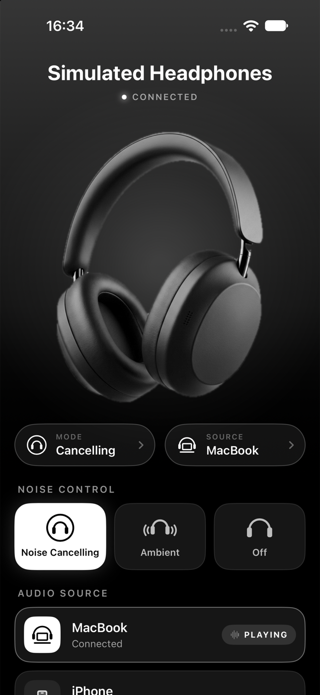
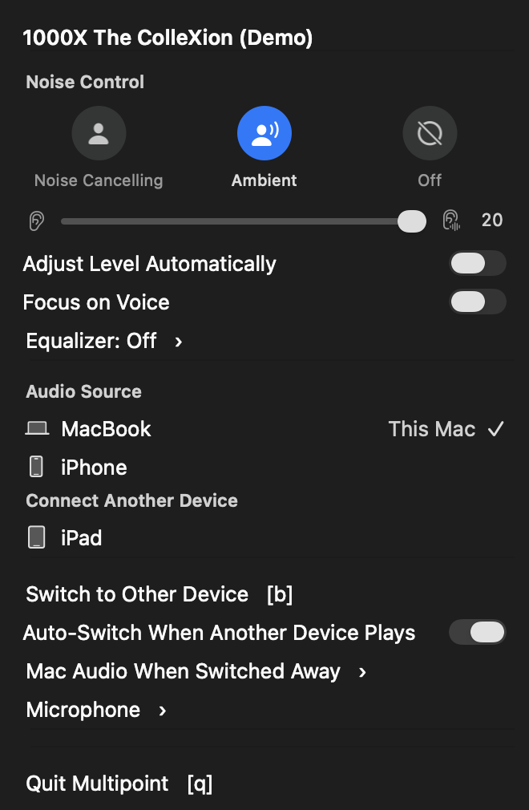
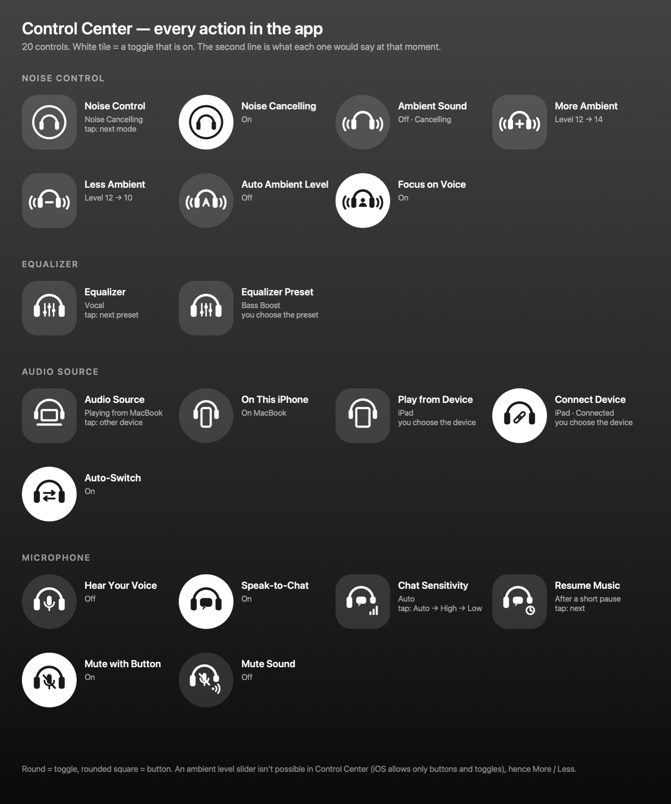

# Multipoint

A tiny macOS menu bar app (with a CLI) and an iPhone app that control Sony headphones: which multipoint-connected
device they play from, noise cancelling and ambient sound, and their microphone settings.
Built for the **Sony 1000X The ColleXion**, and should work with any headphones that use Sony's v2 control protocol,
the same one the Sound Connect app uses (WH-1000XM5/XM6, WF-1000XM5, LinkBuds, …).

Not affiliated with Sony.

<p>
  
  
</p>

## Install

**Mac:** download `Multipoint-<version>.dmg` from the [latest release](../../releases/latest), open it and drag
Multipoint to Applications. It lives in the menu bar and asks for Bluetooth access the first time. Or build it
yourself, see below.

**iPhone:** there's no download, since the App Store won't carry an app that speaks another company's accessory
protocol. Build it with Xcode onto your own phone, or through your own TestFlight; see [iPhone app](#iphone-app).

## What it does

- **Noise Control**: Noise Cancelling, Ambient Sound or Off, one click each. In ambient mode, a slider for how much
  outside sound comes in, *Adjust Level Automatically* and *Focus on Voice*.
- **Equalizer**: the headphones' own presets (Heavy, Clear, Hard, Soft, …) and a slider for each band. Moving a
  band of a fixed preset switches to *Manual*, starting from that preset's levels. The custom presets can be given
  names of your own (*Rename…* in the menu, touch and hold on the iPhone); the headphones store only the bands, so
  each app keeps its own names.
- **Audio Source**: the devices connected to the headphones. Click one to play from it; ⌥-click to disconnect it.
- **⌃⌥⌘B from anywhere** flips the audio to the other connected device. The menu bar icon briefly shows the new source.
- **Connect Another Device**: ask the headphones to connect to any device they're paired with.
- **Auto-Switch When Another Device Plays**: turn this off and the headphones stay on the current source instead of
  jumping when the other device makes a sound. This is Sony's own setting, buried in Sound Connect.
- The menu is live: it updates while open (a switch made on the phone shows up within a couple of seconds), and the
  switches, the slider and the device rows act in place without closing it.
- **Mac audio follows the switch.** The headphones stay connected to the Mac while another device is the source, so
  macOS keeps sending them sound that gets dropped. When Auto-Switch is off (so the headphones won't come back on
  their own), Mac audio moves to another output, by default the last one you used or the built-in speakers. It
  moves back to the headphones when you switch to the Mac. Choose the output, or opt out, under
  *Mac Audio When Switched Away*. With Auto-Switch on, nothing moves: the headphones return to the Mac by themselves
  once the other device goes quiet.
- **Call-quality warning.** While any app records from the headphones' mic, Bluetooth switches them to the
  hands-free profile: 16 kHz mono in both directions, so music and video sound like a phone call. The menu then
  says which app is doing it; click the warning to open that app and pick another mic there.
- **Microphone ▸ Mac Microphone** keeps the Mac's default mic off the headphones. macOS makes them the default
  every time they connect, and Multipoint switches it back, by default to the last other mic you used or the built-in
  one. Pick a specific mic, or *Headphones* to allow theirs. Apps with their own mic setting (Zoom, dictation tools)
  need it changed there.
- **Microphone ▸ Headphones**: the headphones' own mic settings, without Sound Connect: *Hear Your Voice on Calls*
  (sidetone), *Speak-to-Chat* with its sensitivity and how soon the music resumes, and *Mute Mic with Headphone
  Button* with its mute sound. Only what your model reports is shown.
- Connect or disconnect the Mac itself, and open at login.

### It doesn't hold on to the headphones

The headphones give their control channel to one app per device at a time, so an app that stays connected locks out
Sound Connect (and, on the iPhone, any other app). Multipoint connects only while there's something to do:

- while the menu is open, or the iPhone app is on screen;
- for a second or two when you press the shortcut, tap a Control Center control or run a CLI command;
- for about a second when the headphones connect to the Mac, and, only while Auto-Switch is off, when the Mac starts
  playing to them and every 20 seconds while Mac audio is playing to them or has been moved away. Those checks are
  how a switch made on the phone gets noticed, since the headphones only tell the device that asked.

The rest of the time it isn't connected and does nothing: no timers, no polling (about 13 MB of memory, no CPU).

## iPhone app

`iOS/Multipoint.xcodeproj` is the same thing for the iPhone: noise control, the equalizer, audio source, auto-switch
and the headphones' mic settings on one screen. (Mac audio routing and the Mac microphone are Mac matters and aren't there.)

It adds **controls for Control Center**, the Lock Screen and the Action button, which work without opening the app.
There is one for everything the app can do, each with its own symbol (the headphones, with what it controls drawn
around or inside them) and a line of text saying where things stand:

| Group | Controls |
|---|---|
| Noise control | Noise Control (steps through the modes), Noise Cancelling, Ambient Sound, More Ambient, Less Ambient, Auto Ambient Level, Focus on Voice |
| Equalizer | Equalizer (steps through the presets), Equalizer Preset |
| Audio source | Audio Source (switch to the other device), Headphones on This iPhone, Play from Device, Connect Device, Auto-Switch |
| Microphone | Hear Your Voice, Speak-to-Chat, Chat Sensitivity, Resume Music, Mute with Button, Mute Sound |

Control Center has no sliders, so the ambient level moves in steps of two with More / Less, and the equalizer's
bands are only in the app. *Play from Device*, *Connect Device* and *Equalizer Preset* ask which one when you add
them.

The same actions are in Shortcuts and Siri ("Set Noise Control", "Switch Headphones to Other Device", "Turn Headphone
Setting On or Off", …).



To install it without putting the iPhone in Developer Mode, use TestFlight: create an app record for the bundle ID
in App Store Connect once, run `iOS/testflight.sh` to archive and upload, then add yourself to an internal testing
group and install from the TestFlight app. Internal builds aren't reviewed; each lasts 90 days.

Or open `iOS/Multipoint.xcodeproj` in Xcode, choose your iPhone and press Run (needs Developer Mode). Xcode registers the two
bundle IDs and the app group (`group.dev.pkhri.Multipoint`) with your developer team the first time; change the team
and the IDs under *Signing & Capabilities* if you aren't the original author. Then open the app once with the
headphones connected, and add the controls: swipe down from the top-right corner, touch and hold an empty area, tap
*Add a Control* and search for Multipoint.

How it reaches the headphones: iOS has no RFCOMM for apps, but Sony's headphones are "Made for iPhone" accessories
and offer the same byte protocol through the External Accessory framework, under the protocol name
`jp.co.sony.songpal.mdr.link2`. A development-signed app may declare that name; the App Store would not accept it
without Sony's approval, so this is for your own devices. In the Simulator, which has no Bluetooth, the app runs
against simulated headphones.

## Build & install

Requires Xcode (or Command Line Tools) on macOS 13+.

```sh
./build-app.sh            # → build/Multipoint.app
./build-app.sh install    # → /Applications/Multipoint.app
./make-dmg.sh             # → build/Multipoint-<version>.dmg, for handing to others
```

On first launch macOS asks for Bluetooth access. Allow it. The script signs with your Developer ID or Apple
Development certificate when you have one, so the permission survives rebuilds; with an ad-hoc signature macOS asks
again after every rebuild.

## CLI

The same binary works as a command-line tool, which is handy for Shortcuts, Raycast or scripts:

```sh
M=/Applications/Multipoint.app/Contents/MacOS/Multipoint
$M list                  # ▶ playing  ● connected  ○ paired
$M switch iPhone         # by name (substring) or address
$M next
$M connect "iPad"
$M auto-switch off
$M nc ambient 12         # noise control: on | ambient [level 1-20] | off; no argument shows it
$M eq "bass boost"       # equalizer preset; no argument shows the presets and bands
$M eq bands 2 1 0 0 0 0 0 1 2 3   # every band, as levels around flat
$M eq rename custom 1 = Neutral   # your own name for a custom preset, kept on this Mac
$M mic                   # Mac mic, who's using the headphone mic, headphone mic settings
$M list --debug          # dump raw protocol traffic
$M query "t1 D0 D1 01"   # raw request → reply, for exploring the protocol
```

Each command connects, acts and disconnects. The menu bar app can keep running; only close its menu first, since
an open menu holds the channel.

## How it works

Sony headphones expose an RFCOMM service (UUID `956C7B26-D49A-4BA8-B03F-B17D393CB6E2`) that speaks a framed binary
protocol called "MDR". Sound Connect uses it for everything, including the device list. The commands this app uses
(table 2 unless noted):

| Purpose | Payload |
|---|---|
| List paired devices + who's playing | `36 02` → reply `37 02 <count> {addr[17] slot cod[3] len name}… <playbackSlot>` |
| Switch audio source | `3C 01 <addr[17]>` → notification `3D 01 <result> <addr[17]>` |
| Connect / disconnect a device | `3C 02 <01/00> <addr[17]>` |
| Auto-switch setting get / set | `36 01` / `38 01 <0/1>` |
| Speak-to-Chat on/off get / set (table 1) | `F6 0C` / `F8 0C <on> 01` |
| Speak-to-Chat sensitivity & resume time (table 1) | `FA 0C` / `FC 0C <sens> <time>` |
| Sidetone, a self-described "general setting" (table 1) | describe `D0 D1 01`, get `D6 D1`, set `D8 D1 00 <on>` |
| Mic mute with headphone button + sound | `F6 0B` / `F8 0B <on> <sound>` |
| Noise control get / set (table 1) | `66 19` / `68 19 <settled> <on> <ambient> <voice> <level> <auto> <sensitivity>` |
| Equalizer presets and band layout (table 1) | `50 04 01` → `51 04 <bands> <steps> <count> {id len name}…` |
| Equalizer get / set (table 1) | `56 00` → `57 00 <preset> <count> <step>…` / `58 00 <preset> <count> <step>…` (count 0 selects a preset) |
| Equalizer available right now? (table 1) | `52 04` → `53 04 <00 = yes> <reasons…>`; asked as `52 00`, The ColleXion doesn't answer |

In the settings messages, `00` means on and `01` off; noise control is the usual way round (`01` on). `19` is the
noise-control layout of the XM6 and The ColleXion; the XM5's is `17`, without the last two bytes.

Each packet is framed as `3E escape(type seq len32 payload checksum) 3C`, and every packet gets an ACK.

The code is in three layers:

- `Sources/MDRKit`: the protocol's framing and messages. Pure Swift, no Bluetooth.
- `Sources/HeadphoneKit`: `HeadphoneSession` speaks the protocol over any byte transport, and `HeadphoneController`
  is what the apps use: the last known state plus actions that connect on demand and let go afterwards. Shared by
  the Mac and iPhone apps. It also has simulated headphones, which the tests and the Simulator run against.
- `Sources/Multipoint` (AppKit menu bar app and CLI, RFCOMM transport) and `iOS/` (SwiftUI app, accessory-session
  transport, Control Center controls).

The artwork is generated: `iOS/Tools/make-symbols.py` draws the control symbols, `iOS/Tools/CutOutPhoto.swift` cuts
the hero picture out of its background, and `iOS/Tools/MakeIcons.swift` makes both apps' icons from it. The picture
of the headphones is itself an image-model render of generic over-ear headphones made from a text description; it
is not a photo of, or from, any manufacturer.

`swift test` runs the protocol tests and drives the session and controller against the simulated headphones.
`MULTIPOINT_SNAPSHOT_DIR=/some/dir swift test --filter MenuSnapshotTests` draws the Mac menu into PNG files.

The protocol knowledge comes from [mos9527/SonyHeadphonesClient](https://github.com/mos9527/SonyHeadphonesClient)
(MIT), a full open-source Sound Connect replacement that lists *Multipoint Control* as supported on the WH-1000XM6.
This app reimplements a small subset in Swift, so there's no C++ toolchain or dependency.

## Notes

- Tested live on a 1000X The ColleXion (firmware 1.3.0) on macOS 27: listing the devices, switching the source both
  ways, reading and writing the auto-switch and microphone settings, reading noise control and the equalizer, and
  connecting on demand. The iPhone app connects to them too. Writing noise control has so far only run against the
  simulated headphones.
- macOS quirk: IOBluetooth silently drops an RFCOMM open that's sent before its internal session reports
  "powered on", right after a process starts. `BluetoothLink` waits briefly before the first open and retries opens
  that never complete.
- The headphones only notify the device that asked for a switch. The app re-reads the device list every 2 seconds
  while its menu is open, and otherwise only at the moments listed under "It doesn't hold on to the headphones".
- `MULTIPOINT_DEMO=1` runs the menu bar app against simulated headphones.
- The Mac has to be one of the headphones' connected devices to talk to them. When the Mac isn't connected, the menu
  offers "Connect This Mac".
- "Connect to 2 devices simultaneously" must be on in the headphones (it is by default).
- Switching can be refused during a call, while a voice assistant is active, or when the target device has no audio
  link. The menu shows the reason.
- Set `MULTIPOINT_DEBUG=1` when launching the binary directly to log protocol traffic to Console.
